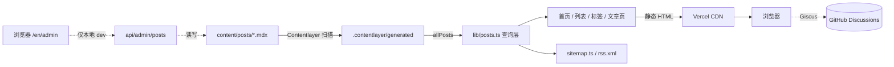

# CodyLink 架构分析与改造记录

> 分析日期：2026-11-04 ｜ 代码基准：Next.js 14.2.35 / Contentlayer 0.3.4 / Tailwind CSS 4.1.18

这篇文档解释「这个博客是怎么跑起来的」，以及两轮改造动了什么、为什么动。日常写文章请看根目录 [README.md](../README.md)。

---

## 一、它是什么类型的站点

**静态优先的 Git 内容站**，不是 WordPress 那类带数据库和后台的动态站。

- 内容源：`content/posts/{en,zh-CN}/*.mdx` 纯文本文件，frontmatter + Markdown/MDX 正文。
- 构建期：Contentlayer 扫描这些文件，编译 MDX，生成 TypeScript 类型和 `allPosts` 数据到 `.contentlayer/generated/`。
- 运行期：Next.js App Router 页面 import `allPosts`，在构建时预渲染成 HTML（`generateStaticParams`），推到 Vercel 后全是静态文件 + 少量边缘中间件。
- 交互部分（主题、搜索筛选、目录、复制、评论、猫咪）作为客户端组件 hydration 到静态 HTML 上。
- 评论是唯一「动态」的外部依赖：Giscus 把评论存在 GitHub Discussions。

**这个选型的好处**：零数据库、零运维成本、内容天然有 Git 版本历史、离线可写、部署免费。**代价**：没有真正的线上后台，评论依赖 GitHub 账号，Contentlayer 已停止维护。

**站点身份**：名字只有 `CodyLink`（无中文别名，双语页面都显示它）；默认语言 `en`，访问 `/` 重定向到 `/en`，另有 `/zh-CN` 完整镜像。

### 数据流



### 路由表

| 路径 | 文件 | 渲染 | 说明 |
|---|---|---|---|
| `/` | `middleware.ts` | 重定向 | → `/en` |
| `/:locale` | `app/[locale]/page.tsx` | 静态 | 首页 Hero（大猫）+ 最近 3 篇 |
| `/:locale/blog` | `blog/page.tsx` | 静态 + 客户端筛选 | 搜索 / 标签 / 年份分组 |
| `/:locale/blog/:slug` | `blog/[slug]/page.tsx` | 静态 | 正文、目录、进度条、上下篇、文末猫、评论 |
| `/:locale/tags` | `tags/page.tsx` | 静态 | 标签云 + 按标签的文章列表 |
| `/:locale/about` | `about/page.tsx` | 静态 | 关于页 + 猫的工牌 |
| `/:locale/rss.xml` | `rss.xml/route.ts` | 静态 RSS | 每语言一份 |
| `/sitemap.xml` | `app/sitemap.ts` | 自动生成 | 含文章 alternates，默认语言不重复 |
| `/robots.txt` | `app/robots.ts` | 自动生成 | 屏蔽后台与 API |
| `/opengraph-image` | `app/opengraph-image.tsx` | 动态 PNG | 站点分享卡片（div 拼的猫脸） |
| `/:locale/admin` | `admin/*` | 客户端 | 本地写作后台，线上 404 |
| `/api/admin/posts` | `api/.../route.ts` | Node 运行时 | 读写 .mdx，线上 403 |

---

## 二、分层与关键文件

| 层 | 文件 | 职责 |
|---|---|---|
| 配置 | `lib/site-config.ts` | 站名、简介、社交、Giscus、备案号、猫的名字与台词 —— 全站唯一配置入口 |
| 内容模型 | `contentlayer.config.ts` | 定义字段、slug/url、阅读时长、字数；注册 remark-gfm / rehype-slug / rehype-autolink-headings / rehype-highlight |
| 内容查询 | `lib/posts.ts` | 按语言过滤、草稿过滤、排序、标签统计、年份分组、上下篇、站点统计、传给客户端前瘦身 |
| 内容写入 | `lib/post-manager.ts` | 后台 CRUD，YAML 序列化、路径安全校验 |
| 界面文案 | `messages/*.json` + `lib/i18n.ts` | 嵌套点路径取值 + `{year}` 占位符替换；`locales` 顺序与 `defaultLocale` |
| 设计系统 | `app/globals.css` | 纸张/贴纸 CSS 变量、`@theme inline` 映射成 Tailwind 类、正文排版、hljs 高亮、猫咪动画 |
| 猫咪插画 | `components/cats.tsx` + `lib/site-config.ts` | 10 种内联 SVG 猫，颜色由 `--cat-*` 驱动，瞳孔统一由 `--cat-eye-x/y` 驱动；`catArtwork.enabled` 可整体切换成 `public/cats/` 下的自定义图片 |
| 鼠标互动 | `components/cat-companion.tsx` | 瞳孔跟随、猫爪光标、点击爪印、摸猫计数与小鱼干彩蛋（自定义事件解耦） |
| 布局 | `app/layout.tsx` | 主题 Provider、页头页脚、纸纹背景、互动层、全站 metadata / OG |
| 路由守卫 | `middleware.ts` | 默认语言前缀补全、线上后台拦截 |
| 客户端增强 | `components/*.tsx` | 摸猫、列表筛选、阅读进度、TOC、代码复制、主题/语言切换 |

---

## 三、第一轮改造：修工程缺陷

| # | 问题 | 影响 | 处理 |
|---|---|---|---|
| 1 | `getMessage()` 用 `messages[locale]['nav.blog']` 取值，但 JSON 是嵌套对象 | **全站文案失效**，页面直接显示 key 名 | 改为点路径逐层遍历，支持 `{count}` 变量替换；根 `i18n.ts` 改为 re-export |
| 2 | Tailwind 4 的 `dark:` 默认走 `prefers-color-scheme`，而 next-themes 用 `class` 策略 | 手动切主题时明暗混杂 | 加 `@custom-variant dark (&:where(.dark, .dark *))` |
| 3 | `formatDate()` 写死中文日期 | 英文站显示「2026年11月4日」 | 按 locale 切换 `MMM d, yyyy`，默认 `en` |
| 4 | Footer 硬编码 `getMessage('zh-CN', ...)` | 英文站页脚是中文 | 改为从 `usePathname()` 取当前语言 |
| 5 | 后台 API 无鉴权，直接 `fs.writeFileSync` | 线上文件系统只读、公开可写接口 | middleware 线上 404、API 线上 403；后台定义为「仅本地开发」 |
| 6 | `post-manager.ts` 把用户 slug 直接拼路径 | 可 `../` 穿越；中文标题生成空文件名；引号破坏 YAML | locale 白名单 + slug 校验、`JSON.stringify` 序列化、解析后回写 |
| 7 | `next/font/google` 引 Inter | 构建依赖外网、中文回退 | 移除，改本地字体栈 |
| 8 | 装了 `rehype-highlight` 却没引入样式 | 代码块没有颜色 | `globals.css` 补 `.hljs-*` 配色 |
| 9 | 无 sitemap / robots / RSS / canonical / OG / 结构化数据 | SEO 基础件缺失 | 补齐，文章页加 `generateMetadata` + BlogPosting JSON-LD |
| 10 | 所有页面都是动态渲染（基线构建全是 `ƒ`） | 无法静态分发 | `[locale]/layout.tsx` 与文章页加 `generateStaticParams`，产出 25 个静态页 |
| 11 | README 写 Next.js 15+，实际 14.2.35；eslint-config-next 16 与 next 14 不匹配 | 文档误导、lint 冲突 | 更正文档，关掉两条 React Compiler 误报规则 |
| 12 | 页脚邮箱/GitHub 是占位信息 | 上线信息错误 | 收敛到 `lib/site-config.ts` |
| 13 | `remark-gfm@4` 与 Contentlayer 的 MDX 2 管线（mdast-util-from-markdown 1.x）不兼容 | 文章里一旦出现**行内代码**（单反引号），`mdast-util-gfm-table` 的 `this.data.inTable` 就抛错，整个构建失败 | 降到 `remark-gfm@3.0.1`（用 `getData/setData` 的 1.x 管线） |

---

## 四、第二轮改造：去模板感 + 猫咪系统

用户反馈「AI 味太浓」。诊断下来，模板感主要来自这几样：**渐变文字、毛玻璃高圆角卡片、极光光晕 + 网格 + 远山、假的「SITE PULSE / LIVE」数据图表、全大写 eyebrow、对仗口号与宏大标语**。全部移除。

**视觉改成「手写笔记本 + 贴纸」**：奶油纸底色与点阵纸纹、暖墨色文字、暖橘主色、2px 实线描边 + 偏移硬阴影（`box-shadow: 3px 4px 0`）、手写体短句（系统手写字体栈）、便签式虚线框、 hover 时轻微歪一点。`.gradient-text` / `.glass-card` / `.chip` / `.btn-*` 保留类名但重新定义，避免改动所有页面。

**猫咪系统**：`components/cats.tsx` 提供 10 种内联 SVG（脸 / 端坐 / 面包 / 睡觉 / 探头 / 纸箱 / 爪印 / 小鱼干 / 走路 / 卡片轮换），配色走 `--cat-*` 变量自动适应明暗主题。它们分布在 logo、Hero 主角、卡片封面、年份分隔、目录顶部、页脚、关于页工牌、404、文末和背景水印。

**第三轮：猫改画成 EveOneCat 风**（用户嫌原来的橘猫矢量贴纸不好看，指定参考 [motions.cat](http://www.motions.cat/)）。重画时**保留全部组件名、props 与 viewBox 比例**，所以所有页面、`cat-companion.tsx`、OG 卡片以外的地方一行没改。新画法：米杏／淡奶黄平涂、深紫褐手绘粗描边、故意不对称的圆润轮廓；脸上只有两个小点眼、一个 `ω` 小嘴和两撇短胡须，去掉腮红 / 虎斑 / 鼻子 / 领结 / 大眼高光；身体是软塌塌的一坨液体猫，身上点缀参考站那种小弯钩爪印。暗色主题切成浅米线稿猫（对应参考站的白线动图）。

循环动效放在 `globals.css`：`.cat-body` 平时安静呼吸、每 3.6s 突然抖一下毛（`cat-jiggle`），`.cat-noodle` 做液体挤压，`.cat-bob` / `.cat-paws` / `.cat-fish-wiggle` / `.cat-tail` 各自低频摆动；悬停任意一只猫时用 `:has()` 让**全站所有猫一起炸毛**。猫头的微抖用独立的 CSS `rotate` 属性而不是 `transform`，避免覆盖 `<g>` 上的 `transform="translate() scale()"`。

**鼠标互动**（`cat-companion.tsx`，仅在 `hover:hover` 且未开 reduced-motion 时启用）：

| 互动 | 实现 |
|---|---|
| 所有猫瞳孔跟着鼠标 | 全局写 `--cat-eye-x/y`，`.cat-pupils` 用 CSS transform 响应，无需每只猫各自监听 |
| 猫爪光标 | 单个 fixed 元素 + `requestAnimationFrame` 阻尼跟随；事件委托判断 `a/button/input/[data-cat-target]`，悬停放大并旋转 |
| 点击爪印 | `pointerdown` 时往 body 插 3 个 DOM，CSS 动画淡出，160ms 节流，卸载时清理 |
| 摸猫 | Hero / 文末猫 dispatch `cat:pet`；Hero 本地冒爱心与台词；累计 5 次触发 `cat:treat`（小鱼干雨） |
| 其它彩蛋 | 点站名冒猫台词、键盘敲 `cat` 触发小鱼干、`Pick for me` 随机跳文章、卡片 hover 探头猫、尾巴摇更快 |

**第四轮：加一条「放图即换」的自定义猫通道**（用户希望自己能替换猫）。`lib/site-config.ts` 顶部新增 `catArtwork: CatArtworkConfig`，`cats.tsx` 每个姿势组件的开头统一调用 `customArt(slot, className, style)`：

| 配置 | 行为 |
|---|---|
| `enabled: false`（默认） | 返回 `null`，继续画内置 SVG，站点零变化 |
| `enabled: true` + `src` | 渲染 `.cat-art` 外壳 + 两层 `background-image`，全站替换 |
| `src: ''` + 某个 `variants.<slot>` | 只替换该位置，其余位置继续用手绘猫 |
| `darkSrc` / `darkVariants` | 暗色主题专用图，`.dark` 下切层 |

用 `background-image` 而不是 `` 或 SVG `<image>`：GIF 能循环播放（SVG `<image>` 在部分浏览器只显示首帧），也不引入 `next/image` 的优化链路。`ART_RATIO` 让每个位置保持与内置 `viewBox` 一致的占位比例，换图后布局不跳；外壳保留 `.cat-svg` 类名，所以 `:has()` 炸毛彩蛋与鼠标互动层不失效。`CatPaw` / `CatFish` 和 `app/opengraph-image.tsx` 的 OG 猫头不参与替换。代价是自定义图没有 `.cat-pupils` / `.cat-body`，瞳孔跟随和抖毛动画不生效，需要由图片自身或额外 CSS 提供。

跨组件通信全部用 `CustomEvent`（`cat:pet` / `cat:party` / `cat:treat`），不引入状态库、不污染 props。

**身份与文案**：站名统一 `CodyLink`，去掉「知山数说」等中文别名与对仗口号；默认语言改 `en`（`lib/i18n.ts` + `middleware.ts` + `app/layout.tsx` 三处同步）；`messages/*.json` 换成口语短句；示例文章也重写成真人语气。

---

## 五、已知限制与后续演进

| 限制 | 说明 | 想解决可以怎么做 |
|---|---|---|
| Contentlayer 0.3.4 已停止维护 | 与 Next.js 15+ 兼容性未知，Windows 构建有已知警告 | 锁在 Next.js 14；升级则迁移到 `next-mdx-remote` / Content Collections / Velite |
| `remark-gfm` 必须锁 3.x | 4.x 的 GFM table 扩展依赖 from-markdown 2.x，会让行内代码炸掉构建 | 升级内容层之后再一起升 remark-gfm |
| `eslint-config-next@16` 与 `next@14` 大版本不一致 | 已关掉两条 React Compiler 误报规则 | 把 eslint-config-next 降到 14.2.x，或整体升级 Next.js |
| 后台无账号体系 | 只能本地用 | 接 GitHub OAuth + Git API 提交，或改存数据库 |
| Giscus 依赖 GitHub | 读者要登录 GitHub；仓库必须公开 | 换 Waline / Twikoo，或去掉 |
| OG 卡片只有英文 | 内置渲染器缺中文字体；猫脸用 div 拼以规避内联 SVG 限制 | 自备字体子集放到 `public/fonts/` 并加载 |
| OG 卡片用 Edge 运行时 | `@vercel/og` 的 Node 版在 Windows 静态预渲染时抛 `Invalid URL`；Edge 版按需生成 | 换 Linux 构建环境后可尝试去掉 `export const runtime = 'edge'` |
| 猫咪互动依赖鼠标 | 触屏 / reduced-motion 下只保留静态插画 | 设计如此；需要触屏反馈可加轻点冒爱心 |
| 无全文搜索索引 / 无访问统计 | 前端遍历（文章量 < 几百篇够用） | Pagefind / Algolia；Vercel Analytics 或 Umami |

### 建议的下一步优先级

1. 把 `NEXT_PUBLIC_SITE_URL`、`siteConfig.social.*`、`giscus.*` 换成真实值。
2. 把 `eslint-config-next` 对齐到 14.x。
3. 决定是否要中文 OG 卡片、是否要访问统计。
4. 内容侧稳定更新；写文章流程见 README 第一节。

---

## 六、验证方式

```bash
npm run typecheck   # TypeScript
npm run lint        # ESLint
npm run build       # 生产构建（类型检查 + 生成静态页）
npm run dev         # 本地逐页看效果
```

构建产物里应能看到 `/[locale]`、`/[locale]/blog/[slug]` 等路由为 `●`（静态），以及 `/sitemap.xml`、`/robots.txt`、`/en/rss.xml`。本地起服务后建议实测：`/` → `/en` 重定向、英文站日期为 `Jan 16, 2025`、中文站为 `2025年1月16日`、不存在的文章返回 404、生产模式 `/en/admin` 返回 404。
